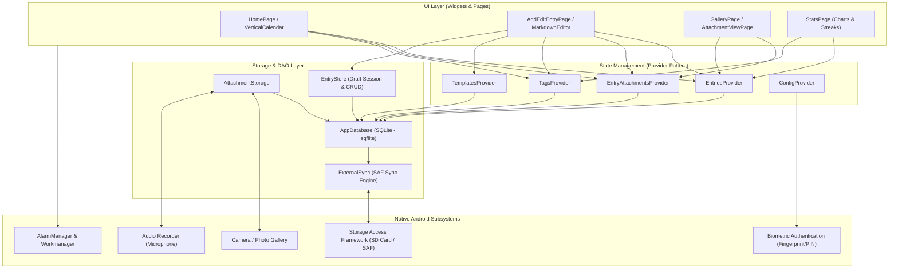
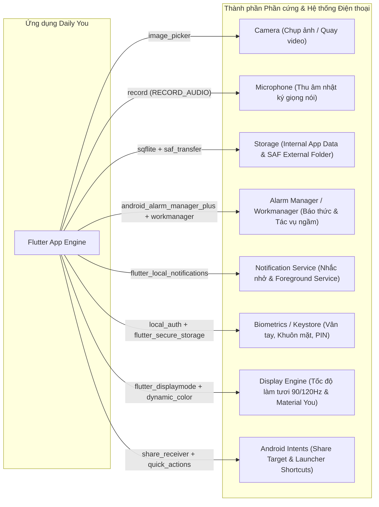

# BÁO CÁO PHÂN TÍCH SOURCE CODE VÀ KIẾN TRÚC TÍNH NĂNG ỨNG DỤNG DAILY YOU

---

## 1. Tổng Quan Dự Án

- **Tên ứng dụng:** Daily You
- **Package Name:** `com.demizo.daily_you`
- **Phiên bản:** `3.7.0+3007000`
- **Giấy phép:** GNU General Public License v3.0 (GPL-3.0)
- **Nền tảng phát triển:** Flutter / Dart (hỗ trợ Android, Linux, Windows, macOS, iOS; tối ưu hóa sâu nhất trên Android).
- **Triết lý cốt lõi:**
  - **100% Offline-First:** Hoạt động độc lập không cần kết nối mạng.
  - **Tôn trọng quyền riêng tư (Privacy-First):** Không quảng cáo, không theo dõi hành vi (không tích hợp Firebase Analytics/Crashlytics), loại bỏ quyền truy cập Internet trong `AndroidManifest.xml` (`<uses-permission android:name="android.permission.ACCESS_NETWORK_STATE" tools:node="remove"/>`).
  - **Toàn quyền kiểm soát dữ liệu:** Người dùng có thể lưu trữ dữ liệu hoàn toàn trên bộ nhớ trong hoặc đồng bộ trực tiếp ra thư mục bên ngoài (thẻ nhớ microSD) thông qua Android Storage Access Framework (SAF).

---

## 2. Cấu Trúc Dự Án và Phân Tích Các File Cốt Lõi

### 2.1. Cây Thư Mục Tổng Thể

```
Daily_You/
├── android/                      # Cấu hình Native Android, AndroidManifest, Gradle
├── assets/                       # Ảnh biểu tượng, minh họa, banner
├── packages/                     # 4 module nội bộ tùy biến riêng cho dự án:
│   ├── backup_crypto/            # Module mã hóa / giải mã bản sao lưu (AES-GCM / PBKDF2)
│   ├── external_opener/          # Tương tác Android FileProvider để mở tệp qua app ngoài
│   ├── saf_transfer/             # Giao tiếp cấp thấp với Storage Access Framework (SAF)
│   └── share_receiver/           # Xử lý nhận dữ liệu chia sẻ (Intent) từ các ứng dụng khác
└── lib/                          # Mã nguồn chính của ứng dụng
    ├── config_provider.dart      # Quản lý cấu hình toàn cục (Settings, Flags, Theme)
    ├── device_info_service.dart  # Thông tin thiết bị và lưu trữ Intent mở app
    ├── flashback_manager.dart    # Quản lý hồi tưởng kỷ niệm "Ngày này năm xưa"
    ├── main.dart                 # Điểm khởi chạy, cấu hình dịch vụ nền, báo thức, theme
    ├── notification_manager.dart # Quản lý kênh thông báo, quyền báo thức chính xác
    ├── time_manager.dart         # Xử lý ngày tháng, hỗ trợ Lịch Dương và Lịch Ba Tư (Jalali)
    ├── database/                 # Tầng dữ liệu SQLite (DAO & Storage Management)
    │   ├── app_database.dart     # Quản lý kết nối DB, schema DDL, version migration
    │   ├── attachment_storage.dart # Quản lý lưu trữ tệp đính kèm (ảnh, video, audio)
    │   ├── entry_dao.dart / entry_store.dart # Truy vấn và lưu trữ bài viết nhật ký
    │   ├── entry_attachment_dao.dart         # Quản lý quan hệ tệp đính kèm
    │   ├── tag_dao.dart / tag_category_dao.dart # Quản lý nhãn và danh mục nhãn
    │   └── template_dao.dart / template_tag_dao.dart # Quản lý các mẫu nhật ký
    ├── models/                   # Các Data Model (Entry, Attachment, Tag, Template, Flashback)
    ├── providers/                # Tầng quản trị trạng thái (ChangeNotifierProvider)
    ├── pages/                    # Các màn hình người dùng (UI Screens)
    │   ├── launch_page.dart      # Màn hình Splash, xác thực sinh trắc học/mật khẩu
    │   ├── home_page.dart        # Màn hình chính: Nhật ký, Flashbacks, FAB tạo mới
    │   ├── edit_entry_page.dart  # Màn hình soạn thảo nhật ký, Markdown toolbar
    │   ├── entry_view_page.dart  # Màn hình đọc chi tiết bài viết
    │   ├── entries_list_page.dart / entry_timeline_page.dart # Dòng thời gian, tìm kiếm, lọc
    │   ├── gallery_page.dart     # Thư viện ảnh/video tổng hợp
    │   ├── statistics_page.dart  # Thống kê, biểu đồ tâm trạng, chuỗi streaks
    │   ├── audio_recorder_page.dart # Màn hình ghi âm nhật ký bằng giọng nói
    │   ├── attachment_view_page.dart # Trình xem ảnh/video/audio toàn màn hình
    │   └── settings/             # 10 trang cấu hình hệ thống
    ├── storage/                  # Trừu tượng hóa lưu trữ (Local FileStore, SAF FileStore, External Sync)
    ├── stats/                    # Logic tính toán thống kê (Streaks, EntryStats, StatsRange)
    ├── utils/                    # Bộ công cụ (Mã hóa, nén Zip, Exif, Markdown, Auto-Backup Schedule)
    │   └── imports/              # Bộ chuyển đổi dữ liệu từ 8 ứng dụng nhật ký khác
    └── widgets/                  # Thư viện thành phần UI tái sử dụng (Lịch dọc, Mood picker, Markdown...)
```

### 2.2. Trách Nhiệm Của Các Tệp Cốt Lõi

| Tệp tin | Vị trí | Trách nhiệm chính |
| :--- | :--- | :--- |
| `main.dart` | `lib/` | Khởi tạo ứng dụng, thiết lập `Workmanager` (sao lưu nền), `AndroidAlarmManager` (báo thức nhắc nhở), cấu hình `DynamicColorBuilder`, tải theme và gắn `MultiProvider`. |
| `app_database.dart` | `lib/database/` | Singleton quản lý SQLite database: khởi tạo 7 bảng, cơ chế snapshot `VACUUM INTO`, migration từ v1 đến v6, đồng bộ hai chiều với bộ nhớ ngoài SAF. |
| `attachment_storage.dart` | `lib/database/` | Quản lý vòng đời lưu trữ của tệp đa phương tiện (ảnh, video, audio), bộ đệm bộ nhớ `FileBytesCache`, dọn dẹp tệp mồ côi (orphans). |
| `edit_entry_page.dart` | `lib/pages/` | Giao diện chỉnh sửa bài viết: chọn tâm trạng (5 mức), trình biên soạn Markdown hỗ trợ Undo/Redo, đính kèm media, gắn thẻ tag và tracker. |
| `vertical_calendar.dart` | `lib/widgets/` | Lịch cuộn dọc hiệu năng cao: vẽ trực tiếp số ngày và hiển thị chấm tâm trạng/tag của từng ngày trong quá khứ. |
| `backup_restore_utils.dart` | `lib/utils/` | Tạo bản sao lưu atomic thông qua SQLite vacuum, nén thư mục Zip, mã hóa AES-GCM với mật khẩu người dùng, phục hồi dữ liệu an toàn. |

---

## 3. Kiến Trúc Ứng Dụng & Luồng Dữ Liệu

Ứng dụng Daily You áp dụng mô hình kiến trúc phân lớp kết hợp với **Provider Pattern** để quản lý trạng thái phản ứng (Reactive State Management).



---

## 4. Xác Định & Phân Tích Chi Tiết Các Tính Năng Chính

### 4.1. Ghi Chép Nhật Ký Đa Phương Tiện (Rich Journaling)
- **Soạn thảo Markdown & Live Preview:** Tích hợp `MarkdownPreviewController` và thanh công cụ soạn thảo `EditorActionBar` nổi trên bàn phím. Hỗ trợ in đậm (`**`), in nghiêng (`*`), gạch ngang (`~~`), tiêu đề H1-H3, danh sách có thứ tự, danh sách gạch đầu dòng, danh sách kiểm việc (checkbox `[ ]`), trích dẫn, khối mã lệnh và chèn liên kết.
- **Hệ thống theo dõi Tâm trạng (Mood Tracking):** Cung cấp 5 cấp bậc cảm xúc (Rad, Good, Meh, Bad, Awful) tương ứng với giá trị số từ 2 đến -2. Cho phép tùy chỉnh bộ biểu tượng cảm xúc (emoji hoặc glyph) trong cài đặt.
- **Phân loại bằng Nhãn (Tags) & Bộ chỉ số định lượng (Trackers):**
  - *Label Tag:* Nhãn danh mục thông thường (ví dụ: `Gia đình`, `Công việc`, `Du lịch`).
  - *Tracker Tag:* Nhãn lưu kèm giá trị (`EntryTag.value`), cho phép ghi lại các thông số cụ thể: lượng nước uống (ly), giờ ngủ (tiếng), chi tiêu (tiền), điểm số năng lượng.
- **Mẫu nhật ký tùy chỉnh (Templates):** Hỗ trợ tạo sẵn các khuôn mẫu định dạng (Morning Gratitude, Evening Reflection). Khi tạo bài viết mới, ứng dụng tự động nạp mẫu mặc định và các tag gắn kèm theo mẫu.
- **Lưu nháp an toàn (Draft Session Dirty Tracking):** Lớp `EntryDraftDirtyTracker` giám sát từng thay đổi văn bản, tránh việc người dùng vô tình bấm thoát làm mất dữ liệu chưa lưu.

### 4.2. Xử Lý Tệp Đa Phương Tiện (Video, Hình Ảnh, Âm Thanh)
Hỗ trợ 3 loại tệp đính kèm được định nghĩa trong enum `AttachmentType` (`image`, `video`, `audio`):

#### A. Xử lý Video
- **Thu thập video:** Quay trực tiếp từ máy ảnh (`ImagePicker().pickVideo()`), chọn từ thư viện (`ImagePicker().pickMultiVideo()`), hoặc nhận qua Android Share Intent.
- **Nén Video thông minh:** Triển khai tại `EntryAttachmentActions._storeVideo()`:
  - Trên Android, ứng dụng sử dụng plugin `v_video_compressor` để giảm dung lượng tệp trước khi lưu.
  - Người dùng cấu hình được chất lượng nén: `Low`, `Medium`, `High`, hoặc `No Compression`.
  - Có cơ chế cảnh báo dung lượng tệp lớn (`AttachmentType.largeFileWarningBytes` đặt ngưỡng 20 MB cho video).
- **Trích xuất Video Thumbnail:** Sử dụng plugin `fc_native_video_thumbnail` trong `video_thumbnail_cache.dart` để tạo ảnh thu nhỏ trực tiếp từ video gốc và lưu vào cache bộ nhớ, giúp danh sách cuộn mượt mà.
- **Phát lại Video:** Sử dụng `video_player` (trên Android) và `video_player_media_kit` (trên desktop) kết hợp các nút điều khiển tùy biến `MediaPlaybackControls`.

#### B. Xử lý Hình ảnh
- **Nén & Tối ưu hóa:** Triển khai tại `EntryAttachmentActions._compressImage()`. Trên Android, ứng dụng sử dụng `flutter_image_compress` với các mức phân giải tối đa (1080p, 1600p, v.v.). Trên Desktop, ứng dụng chuyển tác vụ xử lý sang một `Isolate` riêng biệt qua thư viện `image` để tránh lag giao diện.
- **Xử lý xoay góc & Siêu dữ liệu EXIF:** Sử dụng `ExifOrientation` để đọc và tự động sửa góc quay ảnh theo chiều đúng, bảo tồn thông tin EXIF gốc.
- **Bộ nhớ đệm hình ảnh:** Lớp `FileBytesCache` cấp phát bộ đệm dung lượng 10MB để cache dữ liệu nhị phân đọc từ đĩa, kết hợp với `LocalImageCache` để tái sử dụng texture ảnh.

#### C. Xử lý Âm thanh (Voice Notes)
- **Thu âm giọng nói:** Triển khai tại `AudioRecorderPage`. Ứng dụng sử dụng gói `record` để ghi âm âm thanh chuẩn định dạng M4A/AAC.
- **Giao diện sóng âm (Waveform):** Tích hợp `AudioWaveformDecoration` mô phỏng dạng sóng động trong quá trình thu âm, hỗ trợ nút Tạm dừng (Pause), Tiếp tục (Resume), Hủy (Discard) và Lưu (Save).
- **Phát âm thanh:** Sử dụng gói `just_audio` và `just_audio_media_kit` hiển thị thanh tiến trình phát trực tiếp ngay trên thẻ bài viết hoặc trong màn hình xem chi tiết.

### 4.3. Hồi Tưởng & Kỷ Niệm (Flashbacks / "On This Day")
Quản lý bởi `FlashbackManager`:
- **On This Day (Ngày này năm xưa):** Quét toàn bộ bài viết trong quá khứ có ngày/tháng trùng khớp với ngày hiện tại nhưng khác năm (hỗ trợ cả chu kỳ năm của Lịch Ba Tư).
- **Good Day & Random Day:** Tự động bốc ngẫu nhiên một ngày có tâm trạng tích cực (`mood > 0`) hoặc một ngày bất kỳ từ kho nhật ký cũ để người dùng ôn lại kỷ niệm.
- **Cơ chế Cache Daily Picks:** Lưu trữ ID các bài viết được chọn vào `SharedPreferences`, đảm bảo trong suốt 24 giờ của một ngày, nội dung thẻ Flashback trên trang chủ sẽ cố định, không bị xáo trộn mỗi lần mở lại ứng dụng.

### 4.4. Thống Kê & Phân Tích Thói Quen (Statistics & Streaks)
- **Chuỗi ngày viết liên tục (Streaks):** Tính toán tại `streaks.dart`:
  - *Current Streak:* Số ngày liên tiếp người dùng duy trì viết nhật ký tính đến hiện tại.
  - *Longest Streak:* Kỷ lục số ngày viết liên tục dài nhất từ trước đến nay.
  - *Days Since Bad Day:* Đếm số ngày đã trôi qua kể từ bài viết có tâm trạng tiêu cực gần nhất (`mood < 0`).
- **Trực quan hóa bằng Biểu đồ:** Sử dụng thư viện `fl_chart`:
  - Biểu đồ phân bổ tâm trạng (Mood Distribution Chart).
  - Biểu đồ biến thiên giá trị Tracker theo thời gian (Value Over Time).
  - Biểu đồ xu hướng chỉ số theo từng thứ trong tuần (Value By Day).
- **Bộ đếm tổng số từ (Word Count):** Thống kê số lượng từ đã viết thông qua thư viện `word_count`, lọc được theo khoảng thời gian: 1 tháng, 6 tháng, 1 năm hoặc Tất cả (`StatsRange`).

### 4.5. Quản Lý Dữ Liệu, Sao Lưu & Di Chuyển (Backup & Migration)
- **Cơ sở dữ liệu SQLite:** Schema gồm 7 bảng (`entries`, `entry_attachments`, `tags`, `tag_categories`, `entry_tags`, `templates`, `template_tags`). Tất cả các thao tác xóa bài viết đều tự động dọn dẹp các bản ghi liên kết và tệp đính kèm liên quan.
- **Đồng bộ hóa ngoài qua SAF:** Người dùng có thể chỉ định một thư mục trên thẻ nhớ microSD hoặc bộ nhớ máy để Daily You đồng bộ tự động cơ sở dữ liệu `daily_you.db` và các thư mục `Images`, `Video`, `Audio`. Quá trình ghi file ngoài được debounce 1 giây để tránh nghẽn I/O.
- **Tự động sao lưu ngầm (Auto Backup):** Cấu hình qua `Workmanager`:
  - Lập lịch định kỳ theo chu kỳ ngày, tuần, hoặc tháng.
  - Chỉ kích hoạt khi thiết bị cắm sạc (`requiresCharging`) hoặc thiết bị đang rảnh (`requiresDeviceIdle`).
  - Hỗ trợ tác vụ bù (Catch-up Task) tự động chạy khi mở app nếu lịch định kỳ trước đó bị nhỡ.
- **Mã hóa Sao lưu Cấp cao:** Tệp sao lưu `.zip` được mã hóa chuẩn **AES-GCM** với khóa dẫn xuất từ mật khẩu người dùng thông qua thư viện `backup_crypto`.
- **Bộ nhập liệu từ 8 ứng dụng nhật ký khác:** Thư mục `lib/utils/imports/` hỗ trợ đọc bản sao lưu và di chuyển toàn bộ dữ liệu từ: **Daylio**, **Diarium**, **Diaro**, **Daybook**, **MyBrain**, **OneShot**, **Pixels**, và tệp định dạng chuẩn **JSON**.

---

## 5. Phân Tích Cách Ứng Dụng Sử Dụng Các Thành Phần Thiết Bị



### 5.1. Camera và Thư Viện Media (Camera & Gallery)
- **Quyền liên quan:** Quản lý qua `image_picker` và `permission_handler`.
- **Cơ chế hoạt động:**
  - `ImagePicker().pickImage(source: ImageSource.camera)`: Kích hoạt ứng dụng máy ảnh mặc định để chụp ảnh trực tiếp vào nhật ký.
  - `ImagePicker().pickVideo(source: ImageSource.camera)`: Kích hoạt chế độ quay phim của hệ thống.
  - Hỗ trợ chọn đồng thời nhiều tệp ảnh/video từ album thiết bị.
  - Trên Android, ảnh chụp được lưu vào vùng nhớ đệm tạm thời (`cache`), sau đó được nén và chuyển vào thư mục riêng của ứng dụng `AttachmentStorage.getInternalFolder(type)` trước khi dọn tệp rác.

### 5.2. Microphone (Thu Âm Giọng Nói)
- **Quyền liên quan:** `android.permission.RECORD_AUDIO`.
- **Cơ chế hoạt động:**
  - `AudioRecorderPage` gọi `Permission.microphone.request()` khi mở trang ghi âm.
  - Sử dụng đối tượng `AudioRecorder` từ gói `record` để khởi tạo luồng mã hóa âm thanh trực tiếp vào tệp tạm `.m4a`.
  - Tích hợp vòng đời ứng dụng `WidgetsBindingObserver`: Khi người dùng chuyển ứng dụng khác hoặc có cuộc gọi đến (`AppLifecycleState.paused`), phiên ghi âm tự động chuyển sang trạng thái tạm dừng (Pause) để bảo toàn dữ liệu.

### 5.3. Hệ Thống Lưu Trữ (Storage & File System)
- **Quyền khai báo trong AndroidManifest:**
  - `WRITE_EXTERNAL_STORAGE` và `READ_EXTERNAL_STORAGE` với cờ `android:maxSdkVersion="32" tools:replace="android:maxSdkVersion"`. Từ Android 13 (API 33+) trở lên, ứng dụng chuyển sang sử dụng mô hình Scoped Storage và Storage Access Framework.
- **Cơ chế lưu trữ đa tầng:**
  1. **Internal Storage (Bộ nhớ trong an toàn):** Dùng `path_provider` lấy đường dẫn `getApplicationSupportDirectory()`. Tại đây chứa cơ sở dữ liệu `daily_you.db` và các thư mục media: `Images/`, `Video/`, `Audio/`.
  2. **External Storage qua SAF (Storage Access Framework):** Thông qua gói tùy biến `saf_transfer` và `saf_util`, người dùng có thể cấp quyền một thư mục bất kỳ (ví dụ: trên thẻ nhớ microSD). Ứng dụng lưu giữ `Uri` quyền truy cập vĩnh viễn (`takePersistableUriPermission`), cho phép đọc/ghi đồng bộ mà không cần xin quyền nguy hiểm `MANAGE_EXTERNAL_STORAGE`.
  3. **FileProvider (`external_opener`):** Khi người dùng muốn mở một video hoặc hình ảnh bằng ứng dụng bên ngoài (VLC, Google Photos...), ứng dụng sử dụng `FileProvider` để tạo một `content://` URI an toàn với cờ `FLAG_GRANT_READ_URI_PERMISSION`.

### 5.4. GPS và Định Vị Vị Trí (Location)
- **Phát hiện quan trọng từ source code:**
  - Ứng dụng **hoàn toàn KHÔNG sử dụng GPS** và **KHÔNG khai báo** quyền `ACCESS_FINE_LOCATION` hay `ACCESS_COARSE_LOCATION`. Ứng dụng không ghi nhận tọa độ thời gian thực của người dùng khi viết bài nhằm bảo đảm 100% tính ẩn danh.
- **Quyền `ACCESS_MEDIA_LOCATION` trong AndroidManifest:**
  - Trong `AndroidManifest.xml`, ứng dụng có khai báo: `<uses-permission android:name="android.permission.ACCESS_MEDIA_LOCATION"/>`.
  - *Ý nghĩa kỹ thuật:* Kể từ Android 10 (Q), hệ điều hành mặc định xóa sạch thông tin kinh độ/vĩ độ trong thẻ EXIF của ảnh khi một ứng dụng đọc ảnh từ thư viện. Quyền `ACCESS_MEDIA_LOCATION` cho phép Daily You đọc được siêu dữ liệu EXIF nguyên gốc của các bức ảnh do chính người dùng chủ động tải lên, giúp ứng dụng không làm mất thông tin gốc của ảnh khi nén hoặc sao lưu.

### 5.5. Lịch & Thời Gian (Calendar & Time Management)
- **Tương tác với Calendar hệ thống:** Ứng dụng **không** truy cập vào Calendar cá nhân của điện thoại (`device_calendar`), mà tự triển khai một hệ thống lịch chuyên biệt nội bộ thông qua lớp `TimeManager`:
  - **Hỗ trợ Đa Lịch (Dual Calendar System):** Tích hợp thư viện `shamsi_date`, cho phép chuyển đổi mượt mà giữa Lịch chuẩn quốc tế (Gregorian) và Lịch Ba Tư (Jalali / Solar Hijri). Toàn bộ thuật toán ngày này năm xưa, tính chuỗi viết bài và ngày bắt đầu của tuần đều tự thích ứng theo hệ lịch đang chọn.
  - **Lịch dọc tối ưu hiệu năng (`VerticalCalendar`):** Tự vẽ các ô ngày bằng `CustomPainter` và cache sẵn các số ngày thành bitmap `ui.Image` trong RAM, giúp giao diện lướt qua hàng nghìn ngày nhật ký với tốc độ khung hình tối đa 60/120fps.

### 5.6. Hệ Thống Báo Thức & Thông Báo (Alarms & Notifications)
- **Quyền liên quan:**
  - `RECEIVE_BOOT_COMPLETED`: Tự động đăng ký lại báo thức sau khi khởi động lại máy.
  - `SCHEDULE_EXACT_ALARM`: Cho phép đặt báo thức chính xác tới từng phút.
  - `WAKE_LOCK`: Đánh thức CPU thực hiện tác vụ kiểm tra bài viết.
  - `FOREGROUND_SERVICE` & `FOREGROUND_SERVICE_DATA_SYNC`: Duy trì dịch vụ chạy nền khi sao lưu dữ liệu lớn.
- **Cơ chế hoạt động:**
  - **Nhắc nhở viết bài ngẫu nhiên (Smart Random Reminder):** Hàm `setAlarm()` cho phép người dùng chọn một khung giờ (ví dụ: 18:00 đến 22:00). Ứng dụng sẽ dùng `Random` tính ra một phút ngẫu nhiên trong khoảng đó để gửi thông báo bằng `AndroidAlarmManager.oneShotAt()`.
  - **Thông báo On This Day:** Báo thức chạy ngầm vào giờ cố định, mở kết nối DB SQLite chỉ đọc, kiểm tra nếu có bài viết trùng ngày năm xưa thì mới kích hoạt thông báo nhắc nhở người dùng xem lại kỷ niệm.
  - **Foreground Service Notification:** Khi tác vụ sao lưu tự động kích hoạt bởi `Workmanager`, một thông báo có thanh phần trăm tiến độ được ghim lên thanh trạng thái (cho phép người dùng nhấn nút "Hủy" trực tiếp ngay trên thông báo).

### 5.7. Phần Cứng Sinh Trắc Học & Bảo Mật (Biometrics & Security)
- **Quyền liên quan:** `android.permission.USE_BIOMETRIC`.
- **Cơ chế hoạt động:**
  - Gói `local_auth` giao tiếp trực tiếp với phần cứng bảo mật của điện thoại (Cảm biến vân tay dưới màn hình, Touch ID, Face Unlock hoặc mã PIN màn hình khóa).
  - Khi bật tùy chọn `requirePassword`, `LaunchPage` sẽ chặn toàn bộ luồng khởi tạo cơ sở dữ liệu cho tới khi người dùng vượt qua bước xác thực sinh trắc học hoặc nhập đúng mật khẩu.
  - Mật khẩu và mã khóa được mã hóa bảo vệ trong Android Keystore thông qua gói `flutter_secure_storage`.

### 5.8. Màn Hình & Lối Tắt Hệ Thống (Display & Shortcuts)
- **Tần số quét cao (High Refresh Rate):** Tự động gọi `FlutterDisplayMode.setHighRefreshRate()` trên Android để kích hoạt chế độ màn hình 90Hz hoặc 120Hz mượt mà.
- **Material You Dynamic Colors:** Thông qua `dynamic_color`, ứng dụng tự động trích xuất bảng màu chủ đạo từ hình nền Android của người dùng để tô màu cho toàn bộ các nút bấm và thẻ nhật ký.
- **Quick Actions (Lối tắt trên màn hình chính):** Đăng ký hai lối tắt nhanh thông qua `quick_actions`: "Viết bài hôm nay" (`action_log_today`) và "Chụp ảnh nhanh" (`action_take_photo`).
- **Share Receiver (Nhận dữ liệu từ ứng dụng khác):** Khai báo Intent Filter trong `AndroidManifest.xml` tiếp nhận các kiểu dữ liệu `text/plain`, `image/*`, `video/*`, `audio/*`. Khi người dùng chia sẻ từ trình duyệt, thư viện ảnh hoặc ứng dụng ghi âm, Daily You sẽ tự động mở màn hình `SharePage` để tạo bài viết mới.

---

## 6. Tổng Kết Đánh Giá Kiến Trúc & Chất Lượng Mã Nguồn

| Tiêu chí | Đánh giá | Chi tiết minh chứng |
| :--- | :---: | :--- |
| **Quyền riêng tư (Privacy)** | **Xuất sắc (A+)** | Loại bỏ quyền truy cập Internet (`tools:node="remove"` đối với `ACCESS_NETWORK_STATE`), không có SDK quảng cáo hay analytics, dữ liệu lưu cục bộ và mã hóa. |
| **Tổ chức mã nguồn** | **Rất tốt (A)** | Phân tách module rõ ràng: Tầng Data (DAO), Tầng Trạng thái (Provider), Tầng Giao diện (Pages/Widgets). Tách các tính năng phức tạp thành các package riêng (`packages/`). |
| **Xử lý Đa phương tiện** | **Rất tốt (A)** | Có quy trình nén ảnh/video tự động trước khi lưu trữ; cơ chế cache RAM cho ảnh và thumbnail video mượt mà; hỗ trợ ghi âm trực quan. |
| **Độ ổn định dữ liệu** | **Xuất sắc (A+)** | Dùng `VACUUM INTO` để snapshot DB an toàn; kiểm tra tính toàn vẹn `integrity_check`; sao lưu nền Workmanager thông minh với ràng buộc pin và sạc; hỗ trợ SAF Storage. |
| **Trải nghiệm người dùng (UX)** | **Xuất sắc (A+)** | Thiết kế Material 3 hiện đại, hỗ trợ Dynamic Theming, AMOLED Black, Lịch dọc mượt mà, Flashbacks giàu cảm xúc và hỗ trợ đa ngôn ngữ đầy đủ (trong đó có tiếng Việt). |

